 

&nbsp;

&nbsp;

&nbsp;

 
 

 

 

  

  

 

 

&nbsp;&nbsp;

 

 

 

**🌟 Open Source Contributions**

 

&nbsp;

&nbsp;

 

🪐 <b><a href="https://github.com/jupyterlab/jupyterlab">JupyterLab</a>:</b> Fixed debugger breakpoint lookup across multi-cell console execution in <code>@jupyterlab/debugger</code> (<a href="https://github.com/jupyterlab/jupyterlab/pull/20470">#20470</a>).

 
 

&nbsp;

&nbsp;

 

🚀 <b><a href="https://github.com/RocketChat">Rocket.Chat</a>:</b> Fixed <code>SNAP_ARCH</code> fallback for shared library paths in Snapcraft (<a href="https://github.com/RocketChat/server-snap/pull/85">#85</a>) & core security/engine stability.

 

 

**🚀 Featured Projects**

 

&nbsp;

 
High-concurrency collaborative canvas with room-based WebSockets synchronization.

 
 

&nbsp;

 
AI-powered personal knowledge platform featuring semantic document ingestion & vector search.

 
 

&nbsp;

 
Health and biometric tracking platform with AI-guided personalized wellness analytics.

 
 

&nbsp;

 
High-throughput event delivery and webhook dispatch engine with exponential backoff retries.

 

&nbsp;

&nbsp;

&nbsp;

 

 

<picture>
  <source media="(prefers-color-scheme: dark)" srcset="https://raw.githubusercontent.com/14-himanshu/14-himanshu/output/github-contribution-grid-snake-dark.svg?v=1">
  
</picture>

 

 
<code>Himanshu Pandey · Full-Stack Developer · <a href="https://www.himanshupandey.me/">himanshupandey.me</a></code>

